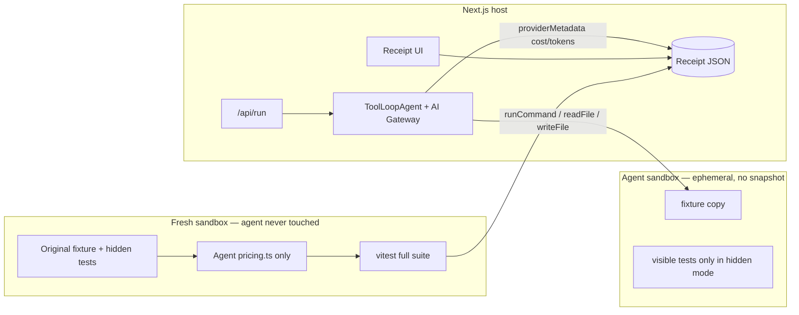

# sandbox-verified-agent

**Agents that show their work.**

A Vercel DevRel demo template: an AI SDK coding agent edits a real failing Vitest suite inside [Vercel Sandbox](https://vercel.com/docs/vercel-sandbox), then a **fresh** sandbox the agent never touched re-runs the full suite (including held-out tests) against the agent’s diff. The result is a **receipt** — claim vs proof, commands, diff, visible/hidden pass/fail, and AI Gateway model/provider/tokens/cost per step.

A green chat message is not evidence. The receipt is.

[](https://vercel.com/new/clone?repository-url=https%3A%2F%2Fgithub.com%2Fdebs-obrien%2Fsandbox-verified-agent&env=AI_GATEWAY_API_KEY,ALLOW_PUBLIC_RUNS&envDescription=Enable%20OIDC%20on%20the%20project%2C%20connect%20a%20Blob%20store%20(BLOB_READ_WRITE_TOKEN)%2C%20and%20optionally%20set%20AI_GATEWAY_API_KEY.%20Set%20ALLOW_PUBLIC_RUNS%3Dtrue%20only%20behind%20Deployment%20Protection.&project-name=sandbox-verified-agent&repository-name=sandbox-verified-agent)

## Who has this problem?

Teams adopting coding agents (support fixes, small refactors, “just make the tests green”) keep asking:

> Did the agent really fix it — and how do I know?

Chat UIs collapse the answer into a confident sentence. This template separates **the agent’s claim** from **independent verification**.

## Why Vercel Sandbox + AI Gateway?

| Piece | Role |
| --- | --- |
| **Vercel Sandbox** | Firecracker microVM for untrusted agent edits + test runs. Network policies lock egress (npm during install, then deny-all). |
| **AI Gateway** | One model string (`provider/model`), OIDC or API key auth, and real `providerMetadata.gateway` fields for provider routing, `generationId`, and `cost` — recorded on the receipt without inventing values. |
| **AI SDK `ToolLoopAgent`** | Tool-calling agent loop (`runCommand`, `readFile`, `writeFile`) with `stopWhen: isStepCount(N)`. |

**Credential choice in this demo:** the LLM runs on the **Next.js host** via AI Gateway. The sandbox never receives `AI_GATEWAY_API_KEY` / OIDC. While the agent works, sandbox egress is **deny-all**.

## Architecture



## The fixture

`fixtures/buggy-pricing/` has **two** intentional bugs (no bug-labelling comments in source):

1. **Threshold (customer report):** `applyBulkDiscount` uses `>` instead of `>=` — quantity `3` never discounts.
2. **Cart aggregation (held-out):** `cartTotalCents` applies the promo from **cart-wide** quantity instead of per-SKU via `applyBulkDiscount`. Looks like a plausible alternate reading of “buy 3 get 10% off” when you only read the function; mixed multi-line carts diverge from per-line semantics.

Why not keep `Math.floor` as the second bug? Live runs showed labelled comments (and even an unmarked `Math.floor` next to “nearest cent” copy) let the model fix rounding without seeing hidden tests. Cart-wide vs per-line is a separate function the visible suite never stresses.

| Suite | File | Role |
| --- | --- | --- |
| Visible | `src/pricing.visible.test.ts` | Quantity-boundary cases only (+ a single below-threshold cart line). A natural `>=` fix — even if cart-wide is also flipped to `>=` — turns these green. |
| Hidden | `src/pricing.hidden.test.ts` | Multi-line / per-SKU cart cases (including below-threshold multi-line). Held out from the agent in **hidden** mode. |

Unit tests only — no Playwright.

## Two modes

| Mode | What the agent sees | What verification runs | Typical verdict |
| --- | --- | --- | --- |
| **normal** | Visible + hidden tests | Pristine fixture + agent `pricing.ts` + full suite | `verified` when threshold **and** per-line cart are fixed |
| **hidden** | Visible tests only | Same independent check **including** held-out tests | Agent honestly `submitClaim({fixed:true})` after visible green; held-out cart tests → `claim-failed-verification` |

The agent is **not** prompted to fail. Same honest instructions in both modes. Hidden mode only changes which test files are copied into the agent sandbox. Claims are structured via required `submitClaim` (not a text token). Every non-error run is pushed to submit a claim: `prepareStep` forces `toolChoice` to `submitClaim` on the final allowed step, and if the loop still ends without one, a single follow-up `generateText` shares the same history with `toolChoice` locked to `submitClaim`. Honest `fixed=false` is fine; **No claim** is reserved for errors or refusal.

## Demo script (talk track)

1. **Normal run (green)** — click **Run normal** or `POST /api/run` with `{"mode":"normal"}`. Agent sees the full suite, fixes threshold + per-line cart, calls `submitClaim({fixed:true})`, independent verify passes → badge **Verified**.
2. **Hidden-tests run (red)** — click **Run hidden-tests demo** or `POST /api/run` with `{"mode":"hidden"}`. Agent only sees visible tests, applies the natural `>=` fix, submits fixed=true. Fresh sandbox re-runs with held-out multi-line cart tests → badge **Caught: claim not supported**.
3. **Open the receipt** — `/receipt/<id>` (UI) and `/api/receipt/<id>` (JSON). Side-by-side claim vs proof; after verification, held-out source is revealed.

Sample receipts (offline): `/receipt/sample-verified`, `/receipt/sample-hidden`.

### Trigger via API

```bash
# Normal — expect verified when credentials are configured
curl -X POST "$HOST/api/run" \
  -H "Content-Type: application/json" \
  -H "Authorization: Bearer $RUN_SECRET" \
  -d '{"mode":"normal"}'

# Hidden-tests — expect claim-failed-verification
curl -X POST "$HOST/api/run" \
  -H "Content-Type: application/json" \
  -H "Authorization: Bearer $RUN_SECRET" \
  -d '{"mode":"hidden"}'
```

Default model: `anthropic/claude-haiku-4.5` (override with `AI_GATEWAY_MODEL` only — client `model` is ignored).

## Public receipt access (for video)

`/api/run` stays gated (`RUN_SECRET` or Deployment Protection + `ALLOW_PUBLIC_RUNS`). Receipts are read-only, but **Vercel Deployment Protection** sits in front of the whole deployment — the app cannot punch a path-level hole by itself.

**Chosen approach (do this in the Vercel dashboard — do not silently disable project protection):**

1. Prefer a **Shareable Link** for the preview/production deployment you will film:
   - Project → Deployments → open the deployment → **Share** → **Anyone with the link**.
   - Use that share URL in the video. Viewers can open `/receipt/<id>` and `/api/receipt/<id>` without signing in to Vercel.
   - Docs: [Shareable Links](https://vercel.com/docs/deployment-protection/methods-to-bypass-deployment-protection/sharable-links)
2. Optional for scripted grabs: enable **Protection Bypass for Automation** and append `?x-vercel-protection-bypass=<secret>` (or the `x-vercel-protection-bypass` header) when fetching receipt URLs.
3. If production should be fully public while previews stay protected: Project → Deployment Protection → protect **Only Preview Deployments**.

Do **not** turn off Deployment Protection for the whole project just for the demo unless you accept anonymous `/api/run` spend (still require `RUN_SECRET` either way).

## Setup

### 1. Clone & install

```bash
npm install
```

### 2. Link a Vercel project (Sandbox + OIDC)

```bash
npx vercel link
npx vercel env pull .env.local
```

### 3. AI Gateway + Sandbox auth (OIDC)

On **Vercel Functions**, the OIDC token arrives as the `x-vercel-oidc-token` **request header**, not as `VERCEL_OIDC_TOKEN`. This app uses `getVercelOidcToken()` from `@vercel/oidc`.

Pick one:

- **On Vercel:** enable OIDC on the project (no env var required for the header path).
- **Linked local:** `VERCEL_OIDC_TOKEN` from `vercel env pull`.
- **API key:** set `AI_GATEWAY_API_KEY` for Gateway (Sandbox still needs OIDC or the token trio).

Optional:

```bash
AI_GATEWAY_MODEL=anthropic/claude-haiku-4.5   # must exist in https://ai-gateway.vercel.sh/v1/models
```

External CI without OIDC also needs:

```bash
VERCEL_TOKEN=…
VERCEL_TEAM_ID=…
VERCEL_PROJECT_ID=…
```

### 4. Connect a Vercel Blob store (required on deploy)

Receipts must survive across function instances. Connect a **Blob** store so `BLOB_READ_WRITE_TOKEN` is available, then redeploy. Locally, when the token is unset, receipts fall back to `./data/receipts`.

### Protect `/api/run` on public deploys

```bash
# Recommended for scripted/API access:
RUN_SECRET=some-long-random

# Or, only behind Vercel Deployment Protection:
ALLOW_PUBLIC_RUNS=true
```

Without one of those, production returns `403`. Client-supplied `model` overrides are ignored. Per-instance concurrency/hourly limits apply (`RUN_MAX_CONCURRENT`, `RUN_MAX_PER_HOUR`).

See `.env.example`.

### Required credentials (checklist)

| Variable / mechanism | Used for |
| --- | --- |
| `getVercelOidcToken()` (`x-vercel-oidc-token` on Vercel) **or** `AI_GATEWAY_API_KEY` / `VERCEL_OIDC_TOKEN` | Model calls via AI Gateway |
| `getVercelOidcToken()` **or** (`VERCEL_TOKEN` + `VERCEL_TEAM_ID` + `VERCEL_PROJECT_ID`) | `@vercel/sandbox` create / snapshot / commands |
| `BLOB_READ_WRITE_TOKEN` (Blob store connected) | Durable receipt storage across instances |

## Run locally

```bash
npm run dev
```

Open [http://localhost:3000](http://localhost:3000).

Fixture-only (no Sandbox):

```bash
npm run test:fixture   # buggy fixture — expects failing tests
npm test               # receipt-building unit tests
```

## Deploy

```bash
npx vercel --prod
```

On Vercel, OIDC covers Sandbox + Gateway via `getVercelOidcToken()`. Connect a **Blob** store. Ensure Sandbox is enabled for the team.

Function duration: `/api/run` sets `maxDuration = 300` (Hobby cap). Sandbox session timeout is 270s.

## Receipt fields

- Big verdict badge: **Verified** / **Caught: claim not supported** / **Not fixed** / **No claim submitted**
- Side-by-side: structured `submitClaim` + files changed + tests it ran vs fresh sandbox id + visible/hidden results + failing output
- Steps, tokens, cost, model, duration, and the diff
- After hidden-mode verification: held-out test source reveal
- **Download JSON** of the same payload (`/api/receipt/<id>`)

## What we learned / rough edges

1. **Alias / resolved `modelId`** — Gateway may echo the requested alias rather than a versioned resolved id. Related: [vercel/ai#21213](https://github.com/vercel/ai/issues/21213).
2. **`providerMetadata.gateway.cost` is not always present** — missing → `"unavailable"`, never invented.
3. **Hobby Snapshot Storage is 15 GB lifetime** — this demo does **not** create per-run snapshots. Agent + verify each use an ephemeral sandbox; sandboxes are deleted afterward (`deleteOrphanSnapshots`). Creating before/after snaps (~800 MiB each, 24h TTL) will fill Hobby quickly.
4. **`runCommand` has no shell** — pipes/`&&` need `bash -c`. Non-zero exits do **not** throw.
5. **File methods vs cwd** — prefer absolute paths under `/vercel/sandbox` after `mkdir -p`.
6. **OIDC is a request header on Functions** — naive `process.env.VERCEL_OIDC_TOKEN` checks false-negative on deploy.
7. **Hobby `maxDuration` is 300s** — keep sandbox timeout under the function budget.
8. **If you do snapshot** — API accepts `0` or `>= 1 day`; use `Snapshot.delete()` / `keepLastSnapshots: { count: 1, deleteEvicted: true }` so storage does not pile up.
9. **Receipts across instances** — use Vercel Blob for `/receipt/[id]` after redirect.
10. **Held-out tests** — omit `*.hidden.test.ts` from the agent copy; verify with pristine fixture + agent diff in a fresh VM.
11. **Public `/api/run` is paid compute** — gate with `RUN_SECRET` or Deployment Protection + `ALLOW_PUBLIC_RUNS`.
12. **Deployment Protection is edge-wide** — use Shareable Links / bypass secret for video; there is no path-only exception for GET.

## Project layout

```
fixtures/buggy-pricing/   # dual-bug fixture + visible/hidden Vitest
src/lib/agent/            # ToolLoopAgent, tools, prompts, run pipeline
src/lib/sandbox/          # create, network policies, pristine+diff verify
src/lib/receipt/          # parse tests, extract LLM steps, totals, store
src/app/                  # UI + /api/run + receipt pages
samples/                  # offline sample receipts (isSample: true)
tests/                    # receipt-building unit tests
```

## License

MIT
