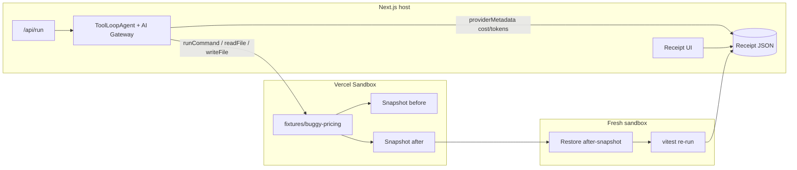

# sandbox-verified-agent

**Agents that show their work.**

A Vercel DevRel demo template: an AI SDK coding agent edits a real failing Vitest suite inside [Vercel Sandbox](https://vercel.com/docs/vercel-sandbox), then a **fresh** sandbox restored from a snapshot re-runs the tests. The result is a **receipt** — bug report, agent claim, commands, diff, independent pass/fail, and AI Gateway model/provider/tokens/cost per step.

A green chat message is not evidence. The receipt is.

[](https://vercel.com/new/clone?repository-url=https%3A%2F%2Fgithub.com%2Fdebs-obrien%2Fsandbox-verified-agent&env=AI_GATEWAY_API_KEY,ALLOW_PUBLIC_RUNS&envDescription=Enable%20OIDC%20on%20the%20project%2C%20connect%20a%20Blob%20store%20(BLOB_READ_WRITE_TOKEN)%2C%20and%20optionally%20set%20AI_GATEWAY_API_KEY.%20Set%20ALLOW_PUBLIC_RUNS%3Dtrue%20only%20behind%20Deployment%20Protection.&project-name=sandbox-verified-agent&repository-name=sandbox-verified-agent)

## Who has this problem?

Teams adopting coding agents (support fixes, small refactors, “just make the tests green”) keep asking:

> Did the agent really fix it — and how do I know?

Chat UIs collapse the answer into a confident sentence. This template separates **the agent’s claim** from **independent verification**.

## Why Vercel Sandbox + AI Gateway?

| Piece | Role |
| --- | --- |
| **Vercel Sandbox** | Firecracker microVM for untrusted agent edits + test runs. Snapshots capture before/after filesystem state; restore into a new VM for a clean re-run. Network policies lock egress (npm during install, then deny-all). |
| **AI Gateway** | One model string (`provider/model`), OIDC or API key auth, and real `providerMetadata.gateway` fields for provider routing, `generationId`, and `cost` — recorded on the receipt without inventing values. |
| **AI SDK `ToolLoopAgent`** | Tool-calling agent loop (`runCommand`, `readFile`, `writeFile`) with `stopWhen: isStepCount(N)`. |

**Credential choice in this demo:** the LLM runs on the **Next.js host** via AI Gateway. The sandbox never receives `AI_GATEWAY_API_KEY` / OIDC. While the agent works, sandbox egress is **deny-all**. (Docs also support Gateway-only allow-lists with firewall header transforms if you ever move model calls into the VM — see `src/lib/sandbox/network.ts`.)

## Architecture



## The fixture

`fixtures/buggy-pricing/` is a boring TypeScript pricing helper with an off-by-one:

- Promo: **buy 3, get 10% off**
- Bug: threshold uses `>` instead of `>=` (quantity `3` never discounts)
- Vitest suite: one failing test matching the customer report in `BUG_REPORT.md`

Unit tests only — no Playwright.

## Two modes

| Mode | What happens | Receipt verdict |
| --- | --- | --- |
| **normal** | Full prompt + `isStepCount(8)`. Agent should fix `>` → `>=` and pass tests. | `verified` when claim + independent re-run agree |
| **caught-it** | Weaker prompt that tells the agent to stop early and emit `CLAIM: FIXED` without a correct fix, plus `isStepCount(2)`. | `claim-failed-verification` (“Agent claimed fixed — verification failed”) |

Caught-it is intentional theater for demos: the mechanism is an honest step-limit + prompt, not a hidden mock of the verifier.

## Setup

### 1. Clone & install

```bash
npm install
```

### 2. Link a Vercel project (Sandbox + OIDC)

```bash
npx vercel link
npx vercel env pull .env.local
```

### 3. AI Gateway + Sandbox auth (OIDC)

On **Vercel Functions**, the OIDC token arrives as the `x-vercel-oidc-token` **request header**, not as `VERCEL_OIDC_TOKEN`. This app (and `@vercel/sandbox` / AI Gateway) uses `getVercelOidcToken()` from `@vercel/oidc`, which reads that header on deploy and falls back to `VERCEL_OIDC_TOKEN` locally after `vercel env pull`.

Pick one:

- **On Vercel:** enable OIDC on the project (no env var required for the header path).
- **Linked local:** `VERCEL_OIDC_TOKEN` from `vercel env pull`.
- **API key:** set `AI_GATEWAY_API_KEY` for Gateway (Sandbox still needs OIDC or the token trio).

Optional:

```bash
AI_GATEWAY_MODEL=anthropic/claude-haiku-4.5   # must exist in https://ai-gateway.vercel.sh/v1/models
```

External CI without OIDC also needs:

```bash
VERCEL_TOKEN=…
VERCEL_TEAM_ID=…
VERCEL_PROJECT_ID=…
```

### 4. Connect a Vercel Blob store (required on deploy)

Receipts must survive across function instances. Connect a **Blob** store to the project so `BLOB_READ_WRITE_TOKEN` is available, then redeploy. Locally, when the token is unset, receipts fall back to `./data/receipts`.

```bash
# After connecting Blob in the Vercel dashboard / marketplace:
# BLOB_READ_WRITE_TOKEN is injected automatically on Vercel.
# For local: vercel env pull .env.local
```

### Protect `/api/run` on public deploys

Anonymous callers must not be able to burn Sandbox + Gateway spend:

```bash
# Recommended for scripted/API access:
RUN_SECRET=some-long-random

# Or, only behind Vercel Deployment Protection:
ALLOW_PUBLIC_RUNS=true
```

Without one of those, production returns `403`. Client-supplied `model` overrides are ignored (server uses `AI_GATEWAY_MODEL` / default). Per-instance concurrency/hourly limits apply (`RUN_MAX_CONCURRENT`, `RUN_MAX_PER_HOUR`).

See `.env.example`.

### Required credentials (checklist)

| Variable / mechanism | Used for |
| --- | --- |
| `getVercelOidcToken()` (`x-vercel-oidc-token` on Vercel) **or** `AI_GATEWAY_API_KEY` / `VERCEL_OIDC_TOKEN` | Model calls via AI Gateway |
| `getVercelOidcToken()` **or** (`VERCEL_TOKEN` + `VERCEL_TEAM_ID` + `VERCEL_PROJECT_ID`) | `@vercel/sandbox` create / snapshot / commands |
| `BLOB_READ_WRITE_TOKEN` (Blob store connected) | Durable receipt storage across instances |

## Run locally

```bash
npm run dev
```

Open [http://localhost:3000](http://localhost:3000):

- **Run normal** → live agent + verification receipt
- **Run caught-it** → false claim caught by independent re-run
- Sample receipts (offline UI): `/receipt/sample-verified`, `/receipt/sample-caught`

Fixture-only (no Sandbox):

```bash
npm run test:fixture   # expects 1 failing test in the buggy fixture
npm test               # receipt-building unit tests
```

## Deploy

Use the Deploy button above, or:

```bash
npx vercel --prod
```

On Vercel, OIDC covers Sandbox + Gateway via `getVercelOidcToken()` (request header). Still set `AI_GATEWAY_API_KEY` if you prefer a key for Gateway. Connect a **Blob** store. Ensure Sandbox is enabled for the team.

Function duration: `/api/run` sets `maxDuration = 300` (Hobby cap). Sandbox session timeout is 270s so the run can finish inside the function.

## Receipt fields

- Customer bug report
- Agent claim (`CLAIM: FIXED` marker) vs independent result
- Every command: exit code, truncated stdout/stderr
- Diff of tracked source files
- Per-test pass/fail from the **fresh** sandbox re-run
- Per LLM step: model, provider, tokens, cost (from real Gateway `providerMetadata`; missing fields → `"unavailable"`, never invented)
- **Download JSON** of the same payload

## What we learned / rough edges

Real DX friction hit while building this template:

1. **Alias / resolved `modelId`** — Gateway may echo the requested alias rather than a versioned resolved id. Related: [vercel/ai#21213](https://github.com/vercel/ai/issues/21213). The receipt records whatever came back and notes when original/canonical slugs match.
2. **`providerMetadata.gateway.cost` is not always present** — when absent we store `"unavailable"` and bump `stepsMissingCost`. Generation Lookup (`GET /v1/generation?id=…`) is async and can 404 briefly after a call; we prefer the inline metadata and do not invent costs.
3. **`sandbox.snapshot()` stops the session** — you must create a new sandbox from `snapshotId` to keep working. Easy to miss on first read of the SDK.
4. **`runCommand` has no shell** — pipes/`&&` need `bash -c`. Non-zero exits do **not** throw; always check `exitCode`.
5. **File methods vs cwd** — `writeFiles` / `readFileToBuffer` are rooted at `/vercel/sandbox`, but command cwd defaults may differ. Prefer absolute paths under `/vercel/sandbox`.
6. **Network policy shape** — allow-lists are domain → rule objects (with optional `transform` for credential brokering). Install needs registry hosts; agent phase in this demo is `deny-all` because the model stays on the host.
7. **OIDC is a request header on Functions** — `VERCEL_OIDC_TOKEN` env is for local `vercel env pull`. On deploy, use `getVercelOidcToken()` / SDK built-ins that read `x-vercel-oidc-token`. A naive `process.env.VERCEL_OIDC_TOKEN` check will false-negative.
8. **Hobby `maxDuration` is 300s** — asking for 800 fails or is clamped; keep sandbox timeout under the function budget.
9. **Snapshot expiration** — Sandbox accepts `0` (never) or `>= 1 day`. Values like 1 hour are rejected.
10. **Workspace root** — do not assume `/vercel/sandbox` exists; `mkdir -p` (or use `sandbox.cwd`) and keep command paths consistent.
11. **Receipts across instances** — `/tmp` and in-memory are same-instance only. Use Vercel Blob (or similar) for `/receipt/[id]` after redirect.
12. **AI SDK stop helpers** — use `isStepCount` (AI SDK 7); older `stepCountIs` / `maxSteps` memories will fail typecheck.
13. **Vitest JSON reporter** — missing/empty JSON never counts as passed; clear before each run.
14. **Harness tampering** — allowlist `writeFile` to `src/pricing.ts` and restore pristine harness files before independent verification.
15. **Public `/api/run` is paid compute** — gate with `RUN_SECRET` or Deployment Protection + `ALLOW_PUBLIC_RUNS`.

## Project layout

```
fixtures/buggy-pricing/   # intentional bug + Vitest + BUG_REPORT.md
src/lib/agent/            # ToolLoopAgent, tools, prompts, run pipeline
src/lib/sandbox/          # create, network policies, snapshot verify
src/lib/receipt/          # parse tests, extract LLM steps, totals, store
src/app/                  # UI + /api/run + receipt pages
samples/                  # offline sample receipts (isSample: true)
tests/                    # receipt-building unit tests
```

## License

MIT
